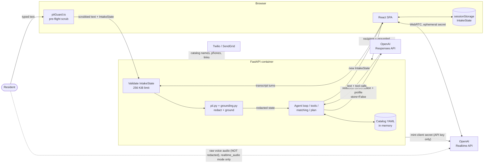

# Architecture

This page describes how the Austin Service Guide is built and how resident data moves through it. It matches the code in this repository. For the security claims behind it, see [SECURITY.md](SECURITY.md); for what is collected and sent to OpenAI, see [docs/PRIVACY.md](docs/PRIVACY.md).

This is a demonstration application. Where something is a stub or not built, this page says so.

## Components

| Component | Technology | Role |
| --- | --- | --- |
| Browser SPA | React 18, TypeScript, Vite, Material UI v7 | Resident portal and staff console. Holds the intake state in `sessionStorage`. |
| API | FastAPI, Pydantic v2 | Stateless intake endpoints, catalog and search, admin demo endpoints. Serves the built SPA in the container image (`STATIC_DIR`). |
| Catalog | YAML files in `backend/app/data/` | 87 services plus categories, life events and crisis resources, loaded into memory at startup. The only data the server holds. |
| OpenAI Responses API | `gpt-5.5-2026-04-23`, `store=False` | Text intake agent loop, greeting, and plan ordering. Called only from the server. |
| OpenAI Realtime API | `gpt-realtime-2` over WebRTC | Opt-in `realtime_audio` voice mode only (needs `VOICE_PIPELINE_MODE=realtime_audio` and `ALLOW_RAW_AUDIO_STREAM=true`). Audio goes directly from the browser. Not used in the default `intercepted_text` mode. |
| Twilio / SendGrid | Optional | Send a list of catalog services by SMS or email. Stubbed when credentials are unset. |

## Data flow



What crosses each arrow, and whether it is redacted:

| Arrow | Contents | Redacted? |
| --- | --- | --- |
| Resident to browser to API | Typed message plus the full `IntakeState` | The browser scrubs the message (`frontend/src/lib/piiGuard.ts`); the server re-redacts every message and profile string (`session_from_state`, `process_message`). |
| API to OpenAI Responses | System instructions (with a profile snapshot), the redacted conversation, tool definitions and results (catalog data) | Yes, by `pii.py`. Redaction is pattern-based and has known limits (see PRIVACY.md). Every call uses `store=False`. |
| OpenAI to API | Model text and tool calls | Tool-call service ids are grounded to the catalog. Model text is not fact-checked; it is redacted with the assistant rules when it re-enters through state. |
| API to browser | Updated `IntakeState`, reply, matches | Matches and cards come from catalog records. |
| Browser to OpenAI Realtime (`realtime_audio` mode only) | Live audio and transcription | **No.** The server cannot see or redact audio. |
| API to OpenAI Realtime | Client-secret request with session instructions and profile snapshot, using the server's API key | Instructions are built from the redacted state. No inbound request headers are forwarded. |
| Browser to API (default `intercepted_text` voice) | The on-device transcript, sent as an ordinary `/message` text turn | Yes: scrubbed in the browser, then re-redacted by the server before any model call. No audio is sent. |
| Browser to API (`realtime_audio` transcripts) | Transcript turns of what was said | Yes, redacted when synced (`record_realtime_transcript`). |
| API to Twilio / SendGrid | The recipient, and a message built from catalog names, phone numbers and `/services/{slug}` links | Catalog data only. The recipient is used for that one send and is not stored. |

## Stateless request lifecycle

Every intake request follows the same steps (`backend/app/routers/intake.py`):

1. The browser sends `{state, ...}` to an endpoint under `/api/v1/intake`. There is no session id.
2. `IntakeBodyLimitMiddleware` (`backend/app/middleware.py`) rejects bodies over 256 KiB with 413.
3. Pydantic validates `IntakeState` (`backend/app/models.py`): version 1, unknown keys forbidden, caps on message count and length, profile fields, and matched ids. A malformed state gets 422.
4. `session_from_state` (`backend/app/services/intake_state.py`) builds a working `IntakeSession`: it re-redacts every message and profile string, grounds matched ids and plan items against the catalog, derives the persona note from `entry_source`, and recomputes risk flags.
5. The endpoint does its work: for `/message`, redact the new text, run the crisis check and scenario follow-up, then the live agent loop (`_responses_flow`) or the scripted flow (`demo_flow`).
6. `state_from_session` converts the result back to a bounded `IntakeState`, and the response returns it.
7. The server keeps nothing. The browser saves the returned state to `sessionStorage` (`frontend/src/lib/session.ts`).

Endpoints under `/api/v1/intake`: `personas`, `load-persona`, `start`, `message`, `results`, `plan`, `share`, `voice-config` (no body, no resident data; returns the effective voice `mode`, `raw_audio_allowed` and `live_ai`), `realtime/client-secret`, `realtime/tool`, `realtime/transcript`, and `realtime/debug*`. `realtime/client-secret`, `realtime/tool` and `realtime/transcript` return 403 unless raw-audio voice is enabled. The debug endpoints return 404 unless `REALTIME_DEBUG_LOG_ENABLED` is set. `/results` makes no model call. `/plan` uses the model when live AI is on, otherwise the rules sequencer.

Because the backend holds no per-resident state, replicas need no session affinity and a restart loses nothing a resident needs.

## Backend module map

`backend/app/`

| Module | Role |
| --- | --- |
| `main.py` | App factory, middleware, routers, `/api/v1/health`, SPA mount when `STATIC_DIR` is set |
| `config.py` | Settings from environment variables; `use_live_ai` |
| `middleware.py` | 256 KiB body limit for intake requests |
| `models.py` | Pydantic models, including `IntakeState` and its size caps |
| `spa.py` | Serves the built SPA with cache headers; API paths that match nothing return JSON 404 |
| `routers/intake.py` | Stateless intake, results, plan, share, realtime voice endpoints |
| `routers/services.py` | Catalog list, search and detail |
| `routers/admin.py` | Demo analytics and audit data; catalog writes behind `X-Admin-Token` |

`backend/app/services/`

| Module | Role |
| --- | --- |
| `ai.py` | Session start, `process_message`, the Responses API agent loop, live greeting, persona sessions |
| `prompts.py` | System instructions for the text agent |
| `tool_schemas.py` | Function-tool schemas shared by text and voice |
| `tools.py` | Tool dispatch and implementations (search, details, crisis, profile, matching, language, completion) |
| `scripted.py` | Scripted intake used when live AI is off |
| `scenarios.py` | Life-event follow-ups and the backend crisis safety net |
| `intake_state.py` | Converts client `IntakeState` to a per-request session and back |
| `grounding.py` | Drops service ids and slugs that are not in the catalog |
| `pii.py` | Deterministic redaction of identifiers |
| `plan.py` | Ordered next-step plan (model-assisted or rules fallback) |
| `matching.py` | Rules-based matching engine, risk flags, benefit estimates |
| `eligibility.py` | Hard eligibility gates used by matching |
| `realtime.py` | Realtime voice session config, voice tool execution, transcript recording |
| `realtime_debug.py` | Opt-in redacted file log for voice troubleshooting |
| `catalog.py` | In-memory catalog store: search, filter, CRUD |
| `catalog_loader.py` | Loads and validates the YAML catalog at startup |
| `seed_data.py` | Legacy hard-coded data, plus synthetic admin demo data |
| `life_events.py` | Life-event scenarios and their starting needs |
| `personas.py` | Demo personas (synthetic residents) |
| `i18n.py` | Hand-translated notices and plan strings for es, vi, zh, ar |
| `hours.py` | Open-now and next-open calculation |
| `notify.py` | Twilio and SendGrid senders with demo stubs and masked logging |

## Frontend structure

`frontend/src/`

- `pages/` resident routes: `Landing`, `Intake`, `DemoIntake`, `Results`, `ServiceDirectory`, `ServiceDetail`, `MapView`, `Login`; and `pages/admin/` for the staff console (demo data).
- `components/`, grouped by feature: `landing/` (`NeedNavigator`), `chat/`, `results/`, `services/`, `map/`, `layout/` (including `StartOverButton`), `common/` (including `PrivacyNotice`, `LanguageSelector`, `catalogFilters`).
- `lib/`: `api.ts` (API client), `session.ts` (client-held intake state), `piiGuard.ts` (client PII pre-flight), `share.ts`, plus helpers.
- `hooks/`: `useBrandConfig`, `useRealtimeVoiceSession` (WebRTC voice), `useAuth` (stub).
- `theme/`: MUI theme built from the city config, plus the contrast gate and the theme guard test.

Tests: `npm test` runs vitest (`frontend/src/lib/piiGuard.test.ts` checks the TypeScript PII guard against the shared fixtures).

## Configuration and white-label flow

```text
config/city.config.json        active config (Austin Public Health values)
config/presets/<id>.json       named presets (austin-travis-tx, bchc-demo-city, cedar-ridge-county)
config/brand/<id>/             logos
config/city.config.schema.json schema they are validated against
        |
        |  CITY_CONFIG=presets/<id>.json at build time
        |  (CITY_PRESET=<id> is an alias; both unset = city.config.json)
        v
frontend/plugins/cityConfigPlugin.ts  validates schema, logo, fonts and contrast; a bad config fails the build
        |  injects __CITY_CONFIG__, writes title + PWA manifest
        v
useBrandConfig() / brandTheme.ts
        -> palette, fonts, header/footer/logo, privacy notice, contact links, map center
```

The brand is fixed into the image at build time. The backend reads the same file (`backend/app/services/city.py`) at startup for the scripted greeting and the system prompt's identity sentence; a missing or malformed config stops startup. Not configurable: the rest of the model prompt, the catalog, crisis resources, life events, personas, and the admin console's demo data are all Austin-specific. See `docs/CUSTOMIZING.md`.

Catalog data flow: YAML in `backend/app/data/services/` is validated against `config/services.schema.json` by `backend/scripts/validate_catalog.py` (`npm run validate:catalog` from `frontend/`) and loaded at startup by `catalog_loader.py`. All 87 services are currently unverified; see SECURITY.md.

## Deployment modes

Both modes run the same image (`Dockerfile`), which needs no database or volume. Templates are starters and have not been applied to live cloud accounts (see [deploy/README.md](deploy/README.md)).

- **Mode A: BCHC-managed, single tenant.** The Big Cities Health Coalition runs one container per city in an isolated cloud project, each with its own secrets and brand preset. The city points a DNS `CNAME` (for example `services.<city>.gov`) at the BCHC-issued hostname. No container, project or secret is shared across cities.
- **Mode B: sovereign municipal cloud.** The city builds, pushes and runs the image in its own account, using the AWS, Azure or GCP template in `deploy/`.

## Implemented and Phase 2 (summary)

Implemented in this repository: stateless intake with a client-held state, structured need navigation, a deterministic PII guard on both client and server, catalog grounding, white-label brand config, a container image and IaC starters, and a logging policy. Details and limits are in [SECURITY.md](SECURITY.md#implemented-hardening-in-this-repository).

Not implemented (Phase 2 roadmap): an AI onboarding and ingestion agent, a human-in-the-loop verification portal, and VPC-isolated multilingual NER guardrails. Also not implemented: staff authentication, rate limiting and WAF, vendor agreements and OpenAI zero data retention, and catalog verification. See [SECURITY.md](SECURITY.md#known-gaps-before-production) and [SECURITY.md](SECURITY.md#phase-2-grant-funded-engineering-roadmap).
